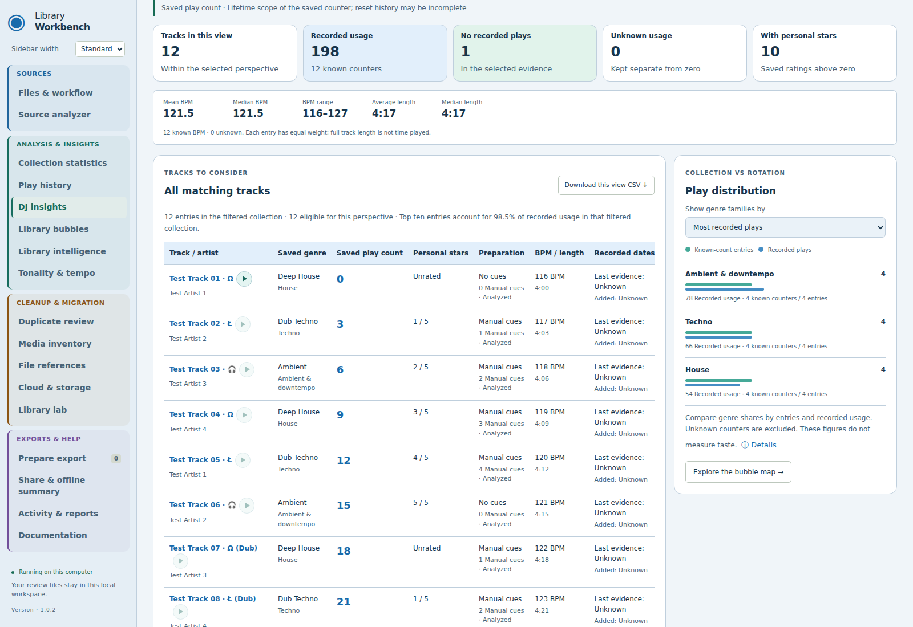
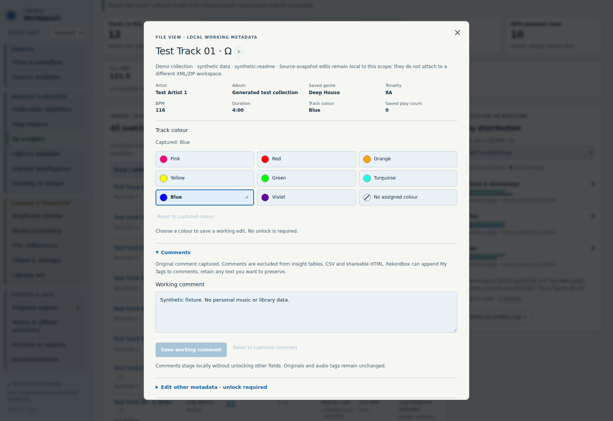
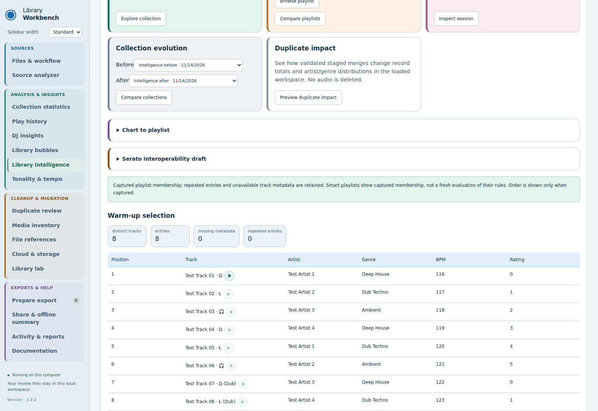
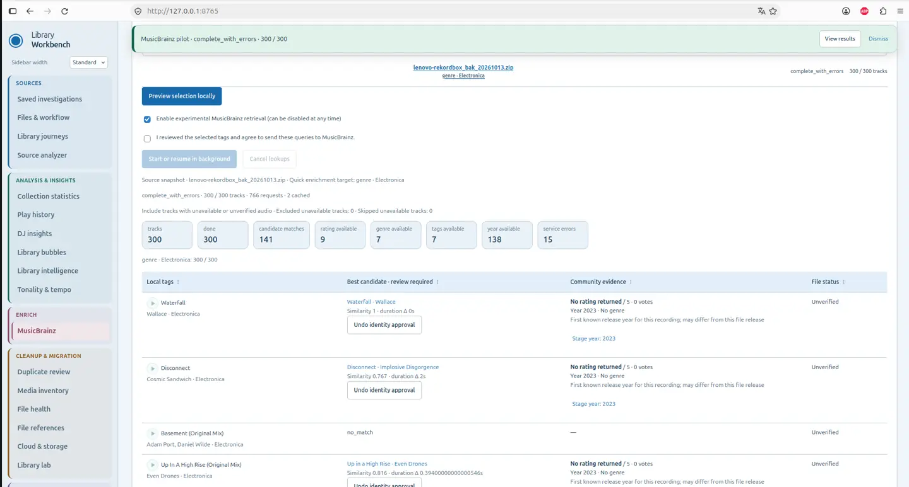
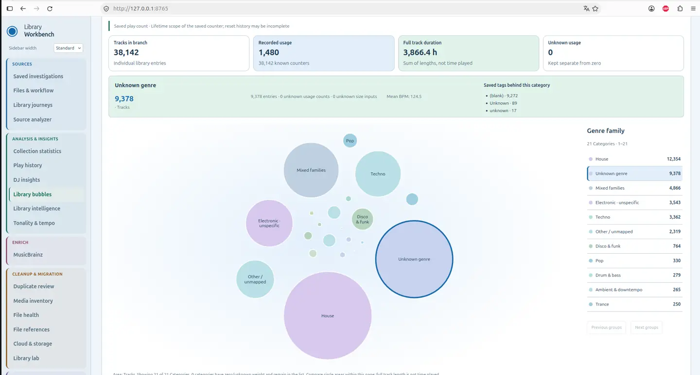

# rekordbox Migration Helper · Library Workbench

<!-- project-badges:start -->

  <!-- Build confidence and release availability -->
  
  
  
  
   
  <!-- Why a DJ might use the project -->
  
  
  
  
   
  <!-- Openness, contribution and source details -->
  
  
  
  
  

<!-- project-badges:end -->

A local browser application for understanding a rekordbox library, reviewing duplicates and preparing edited copies. Use it to prepare a move to a new computer or compare a library before and after a version change: inspect references, preparation and history, then verify the target collection. Linux is the primary development platform. Windows, macOS and Linux x86-64 portable applications are built and exercised by CI.

**DJ insights** adds explainable rotation/discovery views, seeded genre-balanced random picks, a clickable bubble explorer and **Colour cloud**. **Tonality & tempo** inspects saved keys, BPM distributions and duration statistics. The per-track file view opens Comments directly and provides a quick colour palette; both stage local working edits without unlocking other metadata. Everything runs locally over retained snapshots. See the [DJ insights guide](docs/DJ-INSIGHTS.md) for evidence sources, unknown values, grouping rules, colour meanings, privacy and copy-export limits.

The interface offers German, French, Italian, Spanish, Greek, Polish, Czech and Russian alongside English. Controls and offline explorers are localized; source metadata, paths, machine-readable fields and raw diagnostics retain their values. Routine panels use concise technical wording, with detailed procedures in the built-in **Documentation** view. See [translations](docs/LOCALIZATION.md), [Unicode/input checks](docs/UNICODE-INPUTS.md) and [contributing](CONTRIBUTING.md).

See the [migration workflow](docs/MIGRATION.md), [format sources for v5/v6/v7 XML and native libraries](docs/FORMAT-SOURCES.md), and [path discovery, analysis/STEMS audit and play-history guide](docs/DISCOVERY-ASSETS-HISTORY.md). The light interface uses blue, teal, amber and purple navigation accents, compact counters and rounded, spaced sections. Statistics and offline explorers separate addition year from release year. Native histories remain private local snapshot data, browsable after temporary database cleanup.

**Keep a fresh, untouched backup created by rekordbox Backup Library outside this workspace before generating transformed files. Preserve the audio separately when it is excluded from the backup. Native ZIP restoration in rekordbox remains experimental.**

## Related projects

[OneTagger](https://github.com/fantuz/onetagger) complements Library Workbench with automatic metadata lookup, manual audio-tag editing, Quick Tag and file renaming. Desktop and command-line packages are available from its [releases page](https://github.com/fantuz/onetagger/releases/latest).

Use our [OneTagger bridge](docs/AUDIO-MATCHING-AND-ONETAGGER.md#onetagger-handoff) to select local files and review their tag changes. A compatible OneTagger build can load the JSON selection manifest and return a [versioned results report](docs/ONETAGGER-RESULTS.md) with provider evidence; Workbench independently reads the selected files before offering changes. The M3U and tag-rescan workflow remains available. Both tools must run on the same computer. OneTagger writes audio-file tags; Library Workbench stages only the fields you approve, preserving personal stars, cues and original file references.

## Native collection views and saved investigations

- Selecting a captured `master.db` supplies Collection statistics, Duplicate review, File references and Play history without an XML/ZIP workspace.
- Native duplicate review compares recorded paths or artist/title groups, durations, ratings, play counts and cues. Review classifications are saved locally; candidates are not proof of identical audio.
- File references show recorded current, original and analysis paths with search and pagination. Availability still depends on files accessible on the computer running the app.
- Saved investigations offers item/category selection, a dependency preview and reversible archiving of captures, snapshots, reports, MusicBrainz batches, journeys, discovery/storage reports and inactive workspaces. Incomplete source analyses can also be removed.
- Start fresh by archiving current investigations and staged edits, then optionally delete archived analyses permanently after a separate preview. Original libraries, audio, inputs and completed exports are kept.
- Reuse bounded, persistent cached results for saved-collection statistics, duplicate review and file references; changing the source evidence or review decisions invalidates the relevant result. Clear result/provider caches independently of saved reports.
- Restore a cleanup from the same page. Archiving clears menus but retains disk space; original libraries, audio, uploaded inputs and exports are preserved.
- The shared collection header provides a direct **Save a snapshot for insight tools** action. Snapshot creation is an explicit choice.

See [Native views and investigation cleanup](docs/NATIVE-COLLECTION-VIEWS.md) for scope and limitations.

## Interface

These captures use 12 invented test records. No real music catalogue or audio is bundled.

DJ insights brings saved metadata, preparation evidence and play distribution into one view.

Track details keeps listening, comments, colour choices and working edits together.

Library intelligence explores saved playlist membership and order. See [screenshot provenance and regeneration](docs/SCREENSHOTS.md).

### More views from a real library

The next two screenshots were provided by a user from their own music collection (unlike the synthetic CI examples above). They contain visible track titles, genre labels and aggregate counts, but **no audio files or databases**. They are included with explicit permission.

MusicBrainz enrichment compares local tags with public recording candidates; all identity approvals remain reviewable and provider lookups are opt-in.

Library bubbles explores metadata categories visually, including unknown genres and mixed families. The current category breakdown and navigation are generated locally.

## Feature inventory

A factual overview of the current source tree. Release downloads may lag behind `main`; the draft items below retain their stated limits.

**Inputs, discovery and compatibility**

- Discover likely rekordbox data folders from platform defaults, saved application settings and selected search roots.
- Discover custom Dropbox team/customer layouts and local Google Drive locations,
  with provider/OS evidence, bounded searches and explicit source selection.
  Review possible relocation against saved paths; missing prior evidence stays
  unknown. See [cloud-folder discovery](docs/CLOUD-DISCOVERY.md).
- Inspect `master.db` directly or through its containing folder, including differently cased filenames.
- Capture modern databases and their journals into private copies before querying them; detect changing sources.
- Report database integrity, required schema fields, track counts, cues, playlists and reference issues.
- Inspect standalone collection XML without requiring a backup ZIP.
- Detect legacy v5 `.edb` files and report their footprint and missing companion files; native legacy records remain undecoded.
- Distinguish desktop libraries from USB/device exports; device detection does not imply conversion.
- Load matching XML and Backup Library ZIP inputs for duplicate review and copy preparation.

**Library exploration and preparation**

- Inspect backup ZIP coverage and optional bounded SHA-256/CRC verification in Library lab; missing components and captured analysis references stay explicit.
- Run read-only export-readiness checks with a versioned CDJ-2000NXS2 format profile, FAT32 size limits and destination naming advisories; firmware and physical playback remain unverified.
- Review saved BPM versus captured XML/grid tempo, half/double-tempo candidates and saved keys in musical wheel order without changing audio or beatgrids. See [Migration readiness](docs/LIBRARY-LAB.md#migration-readiness).
- Keep immutable metadata snapshots in a separate local SQLite store. Saved editions record a timezone-aware creation time, displayed with local date, time of day and zone in snapshot selectors; older date-only evidence stays date-only.
- Compare snapshots using recorded identity evidence and inspect changes in tags and collection distributions.
- Browse playlists, captured order, repeated entries and missing track metadata.
- Compare playlist overlap and saved order, including tracks shared across several lists.
- Explore tracks outside playlists, recurring across saved sessions, or absent from the captured history.
- Browse native saved history by session and year, retaining repeated entries and unavailable metadata.
- Inspect session progression using saved BPM, key and colour tags; no actual transition timing is inferred.
- Rank rotation and discovery candidates using disclosed play-count, history, cue and date evidence.
- Draw reproducible, genre-balanced random selections with a selection seed.
- Follow eight optional saved journeys for both Serato migration directions, consistency checks, duplicate review, enrichment, metadata refinement, sharing, and backup preparation. Serato → rekordbox is a preparation/checklist workflow; no Serato importer is implemented. Every tool remains accessible independently.
- Browse library bubbles, Colour cloud, tonality, tempo and duration distributions.
- Bubble labels prioritize category names at a consistent 12-pixel size, wrapping up to four lines. Counts remain in the category table and accessible labels; circle areas still represent the chosen metric.
- A prominent “Use local library” entry opens source selection directly, without requiring XML/ZIP exports.
- Compact Rekordbox and Serato cards on Files & workflow open local source analysis and the existing experimental Serato export workflow. Serato library import is not implemented.
- Audit preparation coverage, saved analysis references and STEMS-related evidence.
- Inspect ANLZ framing, grids and repeated cue groups, player-settings CRCs, classic catalog headers and Recordbox STEMS cache structure in **Library lab → Formats & STEMS**, with bounded reads and optional SHA-256 fingerprints. Native STEMS readiness stays Unknown.
- Compare captured active-loop states, BPM/key/play-count changes, playlist moves and folder/smart/manual conversions; preserve duplicate membership and resolve parent identities across renumbered IDs. Known PQT2 fractions receive bounded checks; non-PMAI `.3EX` variants remain Unsupported. See the [Recordbox integrity review](docs/RECORDBOX-INTEGRITY-REVIEW.md) for the broader findings and evidence limits.
- Check **STEMS workflows** for NI-style `.stem.m4a`/`.stem.mp4` containers, RB Stems Plus chunk/manifest completeness, source staleness, declared engine/model profiles and provider-specific source eligibility. Inspect retention expiry and unavailable cache locations separately; see the [STEMS workflow guide](docs/STEMS-WORKFLOWS.md).
- Review captured native artist roles, raw analysis flags, cue anomalies and smart-playlist definitions in **Native source insights**. Unsupported rules and unresolved IDs remain visible; no playlist rule is executed.
- Combine finding section, severity, validation, asset family/provider, cache state, source eligibility/provider and text filters across saved evidence reports and complete filtered JSON downloads. See [format and STEMS inspection](docs/FORMATS-AND-STEMS.md).
- Inspect comments, personal stars, colour assignments and other captured metadata in a single-track view.
- Stage metadata edits in a private sidecar; quick comments and colours remain separate from the original files.
- Play available recorded audio files in the computer's default media player from live track views.
- Save bounded evidence reports for later inspection.
- Enrich the current loaded XML/ZIP library or a connected Rekordbox source, preparing local metadata within the workflow. New MusicBrainz batches default to playable audio, with an explicit override for unavailable files. Category lists show loading and retry feedback; queued and recent batches remain visible with a sticky progress notice.

**Library health, redundancy and storage**

The objective is long-term library maintainability: distinguish redundant records, unavailable tracks, metadata inconsistencies, excess physical copies, and migration readiness. Duplicate detection is only one diagnostic; unavailable audio is not a deletion recommendation.

- Cache local file-access evidence in the private SQLite sidecar and display **Accessible**, **Missing**, **Inaccessible**, or **Unverified** in native duplicate comparisons. Accessible requires a nonempty readable file; decoding and playback remain unverified. Playback checks its path live, and the existing `playable` API key remains compatible.
- Reuse bounded case/Unicode directory lookups for mounted Windows libraries, invalidating indexes when entries change and holding replaced volumes or ambiguous names.
- Explore **File health** across a saved snapshot with an explicit, cancellable scan, counts and global SQLite search, status filtering and sorting. Unchecked records remain distinct from inconclusive Unverified scans.
- Click result table headings to sort the currently displayed rows. Tables with local playback controls also show a sortable file-status column; server-paged tables do not silently reorder their entire library.
- Review connected duplicate groups with keeper selection, donor exclusions and cue/rating conflict evidence.
- Keep duplicate candidates and comparisons in separate scrolling panes, with visible review actions and a keyboard-accessible drawer on narrower screens, for captured databases and XML/ZIP workspaces.
- Review captured-library duplicates in a wider, denser candidate list with compact comparison cards and Save review above the records; retain full paths, ratings and cue counts.
- Compare automatic/manual cue labels, saved waveforms, grids, usage and path evidence.
- Stage compatible merges, retain unresolved conflicts and undo batch decisions.
- Filter candidates by tags, duration, cue category, BPM, bitrate, playlist and media availability.
- Scan selected music folders for relocation candidates and stage reference corrections.
- Use opt-in [Advanced relocate](docs/RECOVERY.md) to find renamed audio through tags and duration, review unique candidates, filter unresolved entries, and download a recovery report with backup guidance. Incomplete and conflicting evidence stays in review.
- Perform optional SHA-256 verification when explicitly requested.
- Audit local and cloud-synced folders for logical size, local allocation, placeholders and possible extra copies.
- Distinguish several records referring to one file from several physical copies; account for overlapping roots and hard links.
- Retain local decisions, saved views, reports and completed exports across restarts.

**External metadata and interoperability**

- Preview MusicBrainz samples of up to 150, 300 or 1,000 tracks, balanced across selected genres.
- Open MusicBrainz from the dedicated **Enrich** sidebar section, with source selection, saved batches, progress and results on one page.
- Run opted-in lookups in the background with pacing, cached results, cancellation, resume and an in-app completion notice.
- See shared loading feedback after 200 ms, a “Waiting…” message after one second without a response or progress change, and elapsed time during longer operations. These notices do not cancel work; existing cancellation controls remain available.
- Read compact, contextual guidance between the page title and language controls rather than repeated full-width notices; expand Details to view full history, statistics and lab explanations and documentation links.
- Review recording matches, separate community ratings and vote counts, genres, tags and release-year suggestions.
- Retain original titles/artists, every search cleanup and attempted query, and candidate disagreements including version differences in both directions. Search cleanup never replaces captured tags automatically.
- Use the [OneTagger bridge](docs/AUDIO-MATCHING-AND-ONETAGGER.md) to hand off up to 500 local files through a selection manifest or M3U. Import version-1 or version-2 results JSON with retained run/provider evidence, or rescan current tags. Independently verify reported tags, review partial/cancelled outcomes, download review evidence and stage only approved title, artist, album, genre or year fields, plus label/composer from version 2. Stale approvals are blocked; original references, personal stars, cues, grids, keys and playlists are preserved. A required CI round trip exercises the production producer and importer with an offline provider.
- Preserve unknown ratings and personal stars; identity approval is required before staging supported suggestions.
- Retrieve public ListenBrainz weekly, monthly or yearly listening charts and match them locally to the selected snapshot.
- Review ambiguous versions and duplicate matches before exporting a chart-ordered M3U8 playlist.
- Preview Serato export coverage, omitted records and playlist entries before downloading. Each generated database and crate is read back and checked for metadata, order and valid references.
- Generate a detached Serato `database V2` and static crate ZIP as an interoperability draft. Real Serato import remains unverified; cues, grids, ratings, history and audio tags are not transferred.

**Outputs and interface**

- Prepare XML and native backup ZIP copies from one frozen decision set, with [independent read-back verification](docs/EXPORT-VERIFICATION.md) of metadata, references, cues and playlist order before publication. A mismatch blocks the complete export set and is reported as an error.
- Keep native backup preparation limited to supported v7 inputs and an explicit backup acknowledgement.
- Export standalone HTML explorers and offline minisites, including filtered CSV downloads.
- Choose public aggregates, a selected track list or a private explorer; file paths are optional and audio is excluded.
- Use shared collection context and guided health-check, migration, duplicate-review and sharing workflows.
- Use compact summary cards, colour-coded navigation and light/dark themes.
- Switch between 13 interface languages without translating source metadata.
- Run Python source or packaged applications on Windows, macOS and Linux; GitHub builds and checks the supported packages.

This inventory describes implemented behavior, not a compatibility certification. See [compatibility](docs/COMPATIBILITY.md), [MusicBrainz](docs/COMMUNITY-RATINGS.md), [chart playlists](docs/CHART-PLAYLISTS.md) and [Serato draft limits](docs/SERATO-BRIDGE.md). Feature changes must update this inventory and their detailed guide in the same PR.

Library intelligence accepts a saved `master.db` capture directly, including playlist explorers, saved-history progression, collection views and retained reports. A separate Library lab snapshot remains useful for preserving a named comparison point. Duplicate impact requires the loaded workspace and staged merges.

## Start with a goal

Choose **Check library health**, **Migrate a library**, **Review duplicates** or **Share & offline summary** on the home page. Migration progress is saved locally. A shared collection context keeps the selected snapshot and evidence scope visible.

**Share & offline summary** turns your collection into a standalone HTML page or an offline minisite ZIP. Start with XML alone, preview the included fields, then choose a public aggregate summary, selected track list or private explorer. Recipients can browse it with the app closed; no music is included. [Sharing guide](docs/OFFLINE-EXPLORER.md).

Prominent tool cards open **Snapshot comparison**, **Metadata editor** and **MusicBrainz**. **Library intelligence** adds playlist overlap, saved session progression, collection evolution and duplicate-impact summaries. [Guided workflows](docs/JOURNEYS.md) · [Insights](docs/LIBRARY-INTELLIGENCE.md) · [Validation still needed](docs/VALIDATION-MATRIX.md).

## Start

<!-- project-downloads:start -->

  

  

  

  

<!-- project-downloads:end -->

The buttons open the latest stable release’s **Downloads** section. New releases include an automatically generated platform table; existing downloads are also available under Assets. Choose your platform; older and prerelease builds remain under [Releases](https://github.com/fantuz/rekordbox-migration-helper/releases). See [what changed in 1.0.2](CHANGELOG.md).

Linux x86-64 users can extract the complete portable TAR.GZ, open the extracted **Library Workbench** folder and double-click **Library Workbench**. Python and dependencies are bundled. Keep the `_internal` folder beside the executable. The package targets desktop Linux with glibc 2.28+ and a browser; CI checks it on Ubuntu 22.04. ARM and Alpine/musl users can use the source version. Older releases may offer Linux source only; current development binaries are under **Actions → Check and package → Artifacts**.

For the Linux source version, use Python 3.13 or newer and run `./start.sh`. The first launch installs requirements into a local virtual environment. The application opens your browser and binds only to loopback. Use **Stop and clean up** in its footer when finished.

Windows users extract the complete portable ZIP and double-click **Library Workbench.exe**. Python and dependencies are included.

**Windows first launch:** the executable is currently unsigned. If Microsoft Defender SmartScreen shows **Windows protected your PC**, and you downloaded this copy from this project’s [GitHub Releases](https://github.com/fantuz/rekordbox-migration-helper/releases), click **More info**, check that the app is **Library Workbench.exe**, then click **Run anyway**. **Unknown publisher** is expected for the unsigned build. If your organization prevents this option, follow its software approval process. You do not need to disable SmartScreen.

Mac users choose the Apple Silicon (`arm64`) or Intel (`x86_64`) archive, extract it and open **Library Workbench.app**. Mac applications are ad-hoc signed, not Developer ID signed or notarized; macOS may restrict opening them. Source checkout remains available for developers.

## Prepare your ZIP and XML

**Create both files in rekordbox, one after the other, without changing the collection between them.**

1. **ZIP:** open **File → Library → Backup Library**. Choose **No** when asked to include music for a smaller analysis backup; **Yes** is also accepted. Keep the audio backed up separately.
2. **XML:** open **File → Export Collection in xml format** and save the XML beside the ZIP.
3. In Workbench, choose **Import XML + ZIP** and select both files. Keep untouched originals outside the workspace.

To test a generated native backup, use **File → Library → Restore Library** in a separate rekordbox library and select **edited-library.zip** without extracting it. Restoring can replace the current collection. The XML is an alternative import route, not a second step after restoring the ZIP. See the [in-app and step-by-step input and restore guide](docs/INPUTS-AND-RESTORE.md) for the complete procedure.

## Two workflows

1. **Source analyzer** reads a source data folder through a private database/journal snapshot. It reports integrity, schema compatibility, track/cue/playlist counters, reference issues and top-level file footprint. Recursive subfolder inventory is optional and bounded to 1,000,000 entries or 120 seconds (whichever comes first); unscanned analysis assets remain unknown. It does not modify the source. Close rekordbox and pause Cloud Library Sync during capture. No XML or ZIP input is required for this mode.
2. **Import XML + ZIP** loads a consecutive Backup Library ZIP and collection XML export. Choose files to copy them into a workspace, or use existing files by full path without another large copy. Compare duplicate groups, cues, ratings and file references, then generate XML and native ZIP together from one frozen decision snapshot.

**Library lab** includes snapshot comparison, metadata consistency, analysis asset audits, genre/BPM preparation coverage and a locked metadata editor backed by a separate local SQLite store. An opt-in MusicBrainz pilot previews up to 150, 300 or 1,000 tracks across selected genres, with background lookup pacing, saved batches and separate community-rating/tag evidence. Sources stay unchanged. See the [Library lab guide](docs/LIBRARY-LAB.md) for scope, privacy, export behavior and limits, and the [changelog](CHANGELOG.md) for additions since 0.4.0.

Source analyzer also reads standalone collection XML for v5 statistics (track counts, artist, title, BPM, duration and other available tags). Native v5 `.edb` records remain undecoded. Analysis copies are removed on acknowledged shutdown; reports, decisions and completed exports are retained. See [temporary-file cleanup and resuming](docs/TEMPORARY-FILES.md).

The **Files & workflow** page explains each step and shows the input and output paths. Completed exports remain downloadable after restarting. Separate single-format exports are also available. Both writers must validate a paired export before its files become available. XML keeps its input collection scope, which can be narrower than the native backup when cloud/device cohorts differ.

Cloud Library Sync supports **Dropbox or Google Drive**. The cloud music folder and the master database folder can differ. Suggested Windows/Mac locations and saved database settings help locate a source, and manual path entry is always available on all platforms. Online-only audio should be downloaded before file-byte verification or playback testing. This application does not authenticate to or operate the cloud providers.

## Compatibility status

| Library | Current handling | Evidence and limits |
| --- | --- | --- |
| v5 and earlier `.edb` | Format detection and file footprint | Legacy records are not decoded or converted |
| v6 `master.db` | Schema-based read-only checks | Same modern SQLCipher family; genuine v6 sample validation pending |
| v7 `master.db` | Read-only checks and experimental copy preparation | Reader/writers checked with v7.2.19 data on Linux; user reports a successful Windows 11 restore, with version recalled approximately as 7.2.19 |
| USB `export.pdb` / `exportLibrary.db` | Detected as a device export | Not treated as the desktop master library |

The major desktop conversion was v5 → v6. AlphaTheta documents that v6 → v7 needs no library conversion. This tool does not implement version downgrading. A format match or successful CI run does not establish that rekordbox will restore a generated backup correctly. See [compatibility and validation](docs/COMPATIBILITY.md).

## Review features

- Manual or mixed cues take keeper priority over automatic-only cues. Newest-added, last-played or play-count policies break ties. Cue origin is inferred from editable labels.
- Connected recording groups show every member with one keeper, donor include/exclude controls and a read-only combined plan. Compatible copies stage together; cue/rating conflicts and indirect-only matches stay held. Batch undo restores earlier choices.
- Evidence filters include recorded paths, saved preview waveforms, cue/grid agreement, ratings, usage, XML membership and optional local file hashes.
- Filters cover track length, cue category, album, artist, genre, label, format, BPM, bitrate, playlist and media availability. Saved views and resumable workspaces retain work locally.
- Media inventory scans only selected roots. SHA-256 reads audio only on explicit request, and unavailable cloud placeholders are held.

## Cloud/local storage audit

**Cloud & storage** compares explicitly selected local, Dropbox and Google Drive music folders. It reads file metadata first and shows visible logical bytes, OS-reported local disk allocation, detected placeholders and possible extra copies. These are scoped folder measurements, not provider account usage.

Copy/Move/Unknown is a user-supplied history hint. An optional source-analyzer report links original/current database paths to physical locations, including renamed cloud files. Multiple database records pointing at one file are distinguished from multiple physical files. Exact filename and size are candidate evidence; explicit SHA-256 verification confirms content. Hard-link aliases and overlapping roots do not count as extra physical copies. Changed files and detected Windows/Mac cloud placeholders are held before hashing. No file removal is performed. Real-world cloud-enabled fixture validation remains pending; synthetic tests exercise both single-track/multiple-file and multiple-record/single-file cases.

## Quick export: an offline metadata explorer

Choose **Quick export**, select the loaded XML/ZIP workspace or a saved source snapshot, and generate a standalone HTML file plus a minisite ZIP. Double-click the HTML file, or extract the complete ZIP and open `index.html`. The application can be closed; neither output needs a server, internet connection or installed dependencies.

Browse genre, year, artist, album, BPM range, personal rating, duration, format and playlist pages. Search and combine numeric filters, drill into category tables, sort and paginate, inspect individual metadata, switch themes and save filtered tables as CSV. Unknown tags remain visible. Playlists can overlap, so playlist totals are not additive.

The export freezes captured source metadata. Staged merges and reference edits are not applied. It contains no audio, artwork, waveforms, cue timestamps, native database or cloud credentials. File paths are excluded unless explicitly selected. This read-only export does not require backup acknowledgement and is not a native backup. Older analyzer reports need a fresh capture to gain a metadata snapshot.

The optional MusicBrainz proof of concept sends selected metadata queries only after the user starts a confirmed pilot. Community evidence stays in the local working database. See [the ratings feasibility study](docs/COMMUNITY-RATINGS.md) and [the library-analysis roadmap](docs/LIBRARY-ROADMAP.md).

## Workspace locations

- Linux portable: `$XDG_DATA_HOME/LibraryWorkbench`, or `~/.local/share/LibraryWorkbench`.
- Linux source: `.data/` beside the application (existing source workspaces stay there).
- Windows: `%LOCALAPPDATA%/LibraryWorkbench`.
- macOS: `~/Library/Application Support/LibraryWorkbench`.

Set `LIBRARY_WORKBENCH_DATA_DIR` to use a different local workspace. The optional `inputs/` folder accepts any ZIP/XML filenames. Import sessions, private analyzer snapshots and exports are separated. Export folders contain `edited-collection.xml`, `edited-library.zip`, `report.json` and an export manifest as applicable. Input files, databases, music, decisions and generated archives are excluded from source control and release source allowlists.

A private precomputed example can be configured in `.data/example.json` or through `LIBRARY_WORKBENCH_EXAMPLE`. No personal library, example database or music is distributed. README screenshots use only 12 invented test records; GitHub generates and discards them while testing. A 0.1-second silent WAV used by the playback test is never packaged. Source archives include the test generators, not their generated libraries. Release verification rejects audio files and recognized rekordbox/Serato library databases.

## Development and packaging

Run `python -m unittest discover -v` after installing `requirements.txt`. The suite covers keeper/cue rules, raw ZIP64 copying, media matching, read-only encrypted/WAL snapshots, source mutation checks, paired-export isolation, backup acknowledgement and platform discovery. CI also checks desktop HTTP startup, Unicode paths and source preservation using synthetic fixtures. No personal library data is uploaded to CI. A pinned English spell-check checks display messages, the README and Markdown documentation; it does not rewrite track metadata or translations.

Windows assembly: `python packaging/build_windows.py` on Linux with MinGW. The archive contains official embedded CPython and matching Windows wheels, checked against publisher/package digests. A Windows CI job launches the actual packaged executable, runs the analyzer and records validation in the artifact.

Mac assembly: install `requirements-build.txt`, then run `python packaging/build_macos.py` on a native Mac. Separate Intel and Apple Silicon jobs package and smoke-test the self-contained app. Linux source archive: `python packaging/build_source.py`. The self-contained Linux build runs `packaging/build_linux.py` inside the pinned manylinux glibc 2.28 image, then tests the bundled ELF on Ubuntu 22.04 with external Python unavailable. See [Linux portable packaging](docs/LINUX-PORTABLE.md).

See [the Windows restore procedure](docs/RESTORE-TEST.md) before testing transformed backups. The project uses the existing [MIT license](LICENSE); bundled dependency licenses remain separate.

## Releases and security

Every pull request and push to `main` automatically tests and builds Windows x64, Mac Intel, Mac Apple Silicon, Linux x86-64 portable and Linux source archives. Download development packages from the run's **Artifacts** section; the final check summary lists the correct artifact for each platform. Development artifacts are retained for 14 days.

For a release, use **Actions → Create release → Run workflow** on `main`, enter a version and choose draft or publication. The workflow builds and validates all five archives, adds the matching changelog entry, direct-download table, complete commit log and installation guidance, then creates the version tag automatically. No local push/tag or personal token is needed. Pushing a `v<version>` tag for a commit already merged into `main` also builds and publishes automatically, as in entropy-service. Plain versions become the latest stable release; alpha/beta/rc versions remain previews. Release downloads remain available separately from temporary CI artifacts. See [release instructions](docs/RELEASING.md).

[SECURITY.md](SECURITY.md) explains private reporting and local trust boundaries. Weekly dependency checks, pinned actions and Dependabot configuration complement the repository's existing default CodeQL setup. [Repository security guidance](docs/REPOSITORY-SECURITY.md) compares DNSProxy/entropy-service and provides importable branch/tag ruleset templates. Merge-policy changes remain a maintainer choice.
