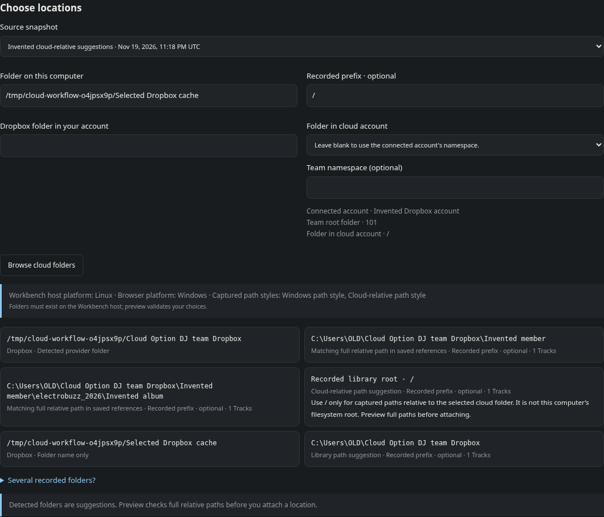

# Connect cloud accounts and attach the right location

**Cloud connections** guides Dropbox and Google Drive setup without changing
the provider's desktop account, selective-sync policy or Rekordbox settings.
Keep using the existing location discovery: its candidates remain suggestions
until you review a library-to-cloud match and explicitly attach it.

## Choose the provider and Rekordbox workflow

Select the saved collection snapshot or source capture whose file references
you want to check. Then choose the provider and describe the workflow you use
in Rekordbox.

| Setting | Dropbox | Google Drive |
| --- | --- | --- |
| Account arrangement | Your own storage, Cloud Option DJ team, or Professional DJ team | Your own Google account/storage |
| Selected music files | Supported; the provider desktop application is optional | Supported; the provider desktop application is optional |
| All music files | Requires the matching Dropbox desktop setup | Not a Rekordbox synchronization option |
| Local download folder | May be the desktop-managed folder or a separate selected-file destination | May be a separate selected-file destination |

The account arrangement is your description of the subscription; Workbench
does not establish billing entitlement from a folder name. A DJ-team folder
is not evidence of a shared login, and a personal-looking folder is not proof
that it belongs to the authorized account.

**Default Cloud Storage** describes the upload destination selected in
Rekordbox. Workbench records this context only. Both providers can remain
connected for verification and individual downloads; Workbench does not
upload music or change Rekordbox's default.

## Authorize the account

Use the provider's own browser sign-in and consent screen. Workbench does not
ask for your Dropbox or Google password. A signed-in desktop client does not
automatically authorize Workbench's API access.

- [Dropbox registration and account setup](DROPBOX-CONNECTOR.md)
- [Google Drive registration and account setup](GOOGLE-DRIVE-CONNECTOR.md)

Authorization must return to the exact local callback displayed by Workbench.
Use the browser and Workbench on the same computer. Remembered authorization
uses an approved operating-system credential store when available; session-only
authorization remains available otherwise.

## Locate and preview

Review the detected folders and their evidence. Provider configuration or OS
registration is stronger evidence than a folder-name hint. Neither method
proves the association with a remotely authorized account.

Returning to this page reuses suggestions for the same saved collection and
detected roots. Changing the collection evidence or detected roots rebuilds
the suggestions. Account, attachment and upload settings refresh each time.

Choose the existing local folder for downloaded audio and the corresponding
remote folder. Dropbox also exposes its account namespace. Google Drive uses
a remote folder identity because names alone are not unique.

Dropbox can report both a **Member home folder** and a **Team root folder**.
The member home is the account's personal member area; the team root is the
root of its team space. Choose the base that contains the intended remote
music folder, then browse or preview its contents. Paths are relative to that
base, so the same folder can need a different path under another base. If
Dropbox reports the same identity for both choices, they refer to the same
root. Workbench uses the signed-in account's reported identities rather than
guessing from a local team-folder name. The choices retain the account's
existing read permissions and still require preview and explicit attachment.

For **selected music files**, the local destination can be outside the
provider's desktop root, including when that desktop application is not
installed. It must be an ordinary existing folder within the server's allowed
local locations. Links, unavailable folders and online-only directory trees
are held rather than traversed or hydrated.

If the collection records an old folder prefix, supply that **recorded root**.
The preview translates its relative paths into the chosen local and remote
folders. It can propose a source-scoped Audio folders mapping, but it does not
rewrite the saved collection or overwrite a conflicting mapping.

### Browser, Workbench host and captured paths

The location step shows **Workbench host platform**, **Browser platform** and
**Captured path styles** separately. The host runs Workbench and accesses the
chosen filesystem folders. The browser hint is derived locally from available
browser platform information, with a user-agent fallback. Captured styles
describe saved reference spellings and can differ from both current platforms.
Cloud-relative paths and generic POSIX paths remain distinct from recognized
Windows, macOS or Linux styles; a leading `/` alone does not identify an
operating system.

This feature stores no raw browser platform/user-agent identifiers and adds no
telemetry. Its coarse labels can be unknown and do not authorize filesystem
access or select an account. Detected provider roots, full-path correlations,
logical recorded roots and other suggestions remain ordered choices, with
manual entry available. The selected folders must exist on the Workbench host;
the existing preview, path-boundary checks and explicit attachment still apply.

### Old Windows profiles and cloud-relative references

The recorded root describes the library's saved references, while the local
folder describes this computer. They need not have the same username. For
example, an invented collection can record:

- Current reference: `/Music/House/Example.mp3`
- Original reference:
  `C:\Users\OLD\Dropbox (Example team)\Alex Example\Music\House\Example.mp3`
- Current local member folder:
  `C:\Users\NEW\Dropbox (Example team)\Alex Example`

A suggestion labelled **Matching full relative path in saved references**
correlates the complete `Music/House/Example.mp3` tail, not just the filename.
It can propose the precise old member-folder prefix. Current, XML and original
references contribute evidence, with a track counted once in each suggestion.
Review the old prefix and chosen current folder before accepting the preview.

**Recorded library root · /** is an explicit logical choice for captured paths
relative to the selected cloud folder. It does not mean the root of this
computer's filesystem, and it never authorizes a filesystem-wide search. Use
it only when the complete relative paths match the selected cloud location.
There is no automatic attachment or conversion of arbitrary absolute paths.

If several recorded prefixes share one cloud account, keep their common cloud
folder selected. Expand **Several recorded folders?** and choose **Review Audio
folders mappings** for that same collection. A longer recorded prefix takes
priority over a general one. For example, an explicitly confirmed mapping
from `/contents_ABC123` to
`C:\Users\NEW\Dropbox (Example team)\Alex Example\Chosen music\contents_ABC123`
can coexist with `/` mapped to the common member folder. The names and location
here are invented: select the actual folder rather than assuming every
`contents_*` directory is beneath `rekordbox` or another fixed subfolder.
These directories can contain the real music and are not metadata sidecars.

Return to the attachment preview and inspect complete local and remote paths
for both ordinary and `contents_*` references. A matching basename or an old
username alone is insufficient. Existing source-scoped mappings remain
explicit, and attachment still requires the complete preview and confirmation
below. No source references, provider settings or files are changed by a
suggestion.

#### Moving between Windows and macOS

The same explicit mapping works in either direction. These invented examples
separate an older recorded root from the current local member folder:

| Move | Recorded root | Current local folder |
| --- | --- | --- |
| Windows → macOS | `C:\Users\OLD\Dropbox (Example team)\Alex Example` | `/Users/NEW/Library/CloudStorage/Dropbox-ExampleTeam/Alex Example` |
| macOS → Windows | `/Users/OLD/Library/CloudStorage/Dropbox-ExampleTeam/Alex Example` | `C:\Users\NEW\Dropbox (Example team)\Alex Example` |

Provider-managed folder names vary. Choose the actual current folder, retain
the source collection's recorded prefix and preview full relative paths before
attaching. The browser's platform label does not convert paths, rewrite the
library, choose a filesystem destination or replace this review.

**Preview** lists remote metadata and matches complete relative paths against
the selected collection. It does not open audio or download recordings. Review
the account, folder identities, example tracks, destination paths and counts.
An identical filename by itself does not establish a match. A matching cloud
path does not prove that a resident local file has identical audio bytes.

## Attach deliberately

Attach is offered only after a complete preview finds at least one matching
track and no ambiguous matches. An incomplete listing, wrong folder, duplicate
remote path or changed source remains unverified. A failed request does not
turn unchecked files into missing files.

The confirmation expires after two minutes and can be used once. Workbench
rechecks the selected account, collection, mappings and local folder identity
before saving the attachment. Changed details require another preview.

The attachment records the verified relationship. Any accepted Audio folders
proposal remains local to its collection scope. Captured file references,
original databases and audio tags remain unchanged.

**Detach** removes the Workbench attachment. It does not delete local or cloud
files, move folders, change provider sync settings or disconnect the other
provider.

## Check files and download one recording

Use the provider's connector page for an explicit metadata check over the
attached collection. Remote presence, local availability and audio integrity
are separate evidence. Filters and pagination apply to the indexed result for
the selected source and account.

File health displays the saved result under **Cloud presence**, alongside its
separate **Local access** result. **Scan local files** does not query the cloud
provider. To populate cloud presence, use **Check remote files** for that same
saved snapshot or source capture; signing in or scanning another collection
does not establish the current collection's result. Viewing the saved evidence
does not start another scan or download.

Each file download requires its own filename, destination and size
confirmation. The connector verifies the current remote identity and content
checksum before publishing one complete file without overwriting an existing
file or placeholder. Private staging stays outside managed cloud trees and
must be on the destination filesystem. Parent folders must already exist;
the current limit is 8 GiB per file.

Existing cloud placeholders retain the individual **Play** confirmation so the
provider can hydrate that one file. Attaching a folder, opening this page,
autodetection and metadata checks do not start content downloads.

## Rekordbox documentation and limits

The [Cloud Library Sync guide](https://cdn.rekordbox.com/files/20251202174725/rekordbox7.2.8_cloud_library_sync_operation_guide_EN.pdf),
pages 9, 11, 15, 20 and 24, documents selected/all synchronization, both-provider
downloads, one default upload provider and configurable selected-file download
destinations. Google Drive for desktop is optional; the
[Rekordbox FAQ recommends Stream files](https://rekordbox.com/en/support/faq/library-sync-7/#faq-50642)
when it is used. Its stream/mirror setting is separate from Rekordbox's sync
method and Workbench's attachment.

Automated checks use invented account identities, provider responses and
temporary files. They do not prove live account, managed-team, virtual-drive
or desktop-client reconciliation behavior. A provider API accepting a folder
does not establish that every Rekordbox plan or DJ hardware model supports
that layout. CloudDirectPlay compatibility is separate from these desktop
verification and download features.
