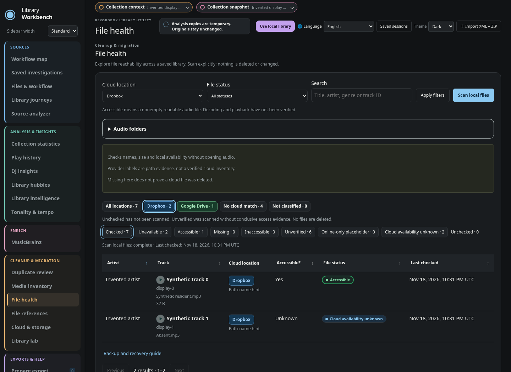
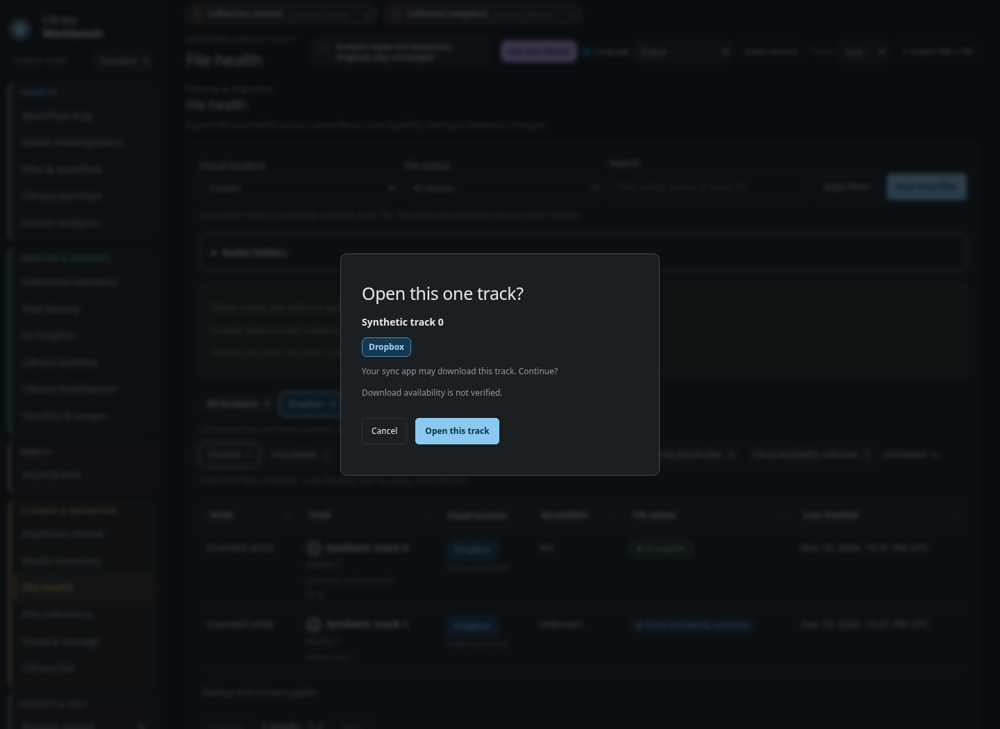

# Cloud paths and file health

Open **File health**, choose the source in **Collection snapshot** above the
page header, and start **Scan local files** (**Scan files** in version 1.2.0).
The scan checks recorded paths and
saved audio-folder mappings. It inspects filesystem attributes, logical size
and local readability; it does not open audio, calculate audio hashes, launch a
player or call a cloud API.

**Local access** and **Cloud presence** answer different questions. Local
**Yes** means the scan found a nonempty, readable local audio file; **No**
groups Missing and Inaccessible; **Unknown** means local access has not been
established. A cloud file can exist remotely while local access remains
Unknown because there is no resident file or only an online-only placeholder.

To check remote presence, connect and attach the provider in **Cloud
connections**, then use **Check remote files** on its connector page. Choose
the same saved collection snapshot or source capture as File health. Signing
in alone does not run this check, and a check of another saved collection does
not establish the result for the current one.

The **Cloud presence** column shows the saved Dropbox or Google Drive result
and its check time separately from local access. Opening or filtering File
health reads that saved evidence without starting another remote scan or
download. Changed accounts, sources or mappings cannot reuse an unrelated
check. **Reachable** establishes remote metadata presence; it does not prove
local residency, byte equality or decodable audio.

Dropbox evidence also compares the remote size with the selected library's
captured size when both are available. Matching sizes support a path match;
different sizes call for review, and absent size evidence remains unknown.
These labels do not hash or download audio. An **Unverified** local result
can therefore appear beside **Reachable** cloud evidence without conflict.

Progress batches during **Scan local files** describe the local scan's work.
A provider desktop client may make its own metadata requests while the scan
inspects its folders. Those requests do not establish a completed Workbench
cloud inventory; the connector's explicit check supplies that evidence.

The blue **Dropbox** and green **Google Drive** filters apply to the complete
saved scan before pagination. Labels describe configured provider roots or
recognizable directory names. A filename such as `Dropbox.mp3` alone is not a
provider match. Original and mapped paths can provide different provider
matches for the same library entry. **No cloud match** means no matching path
evidence; it does not prove that a file is outside all cloud storage.

The Cloud location column distinguishes detected roots from path-name hints.
Filenames and available logical sizes appear alongside track titles. These
sizes are filesystem metadata, not downloaded bytes or proof of resident audio.
Old scan rows show **Not classified** until an explicit new scan classifies them.

## Local absence and placeholders

A Dropbox recording can remain available to rekordbox even when selective sync
leaves no local file. Such paths show **Not available locally**, not proof of
deletion. An absent path cannot establish whether the remote file exists;
consult the separate Cloud presence result or run its explicit check.
An OS-reported online-only placeholder is shown separately and is not marked
locally accessible just because it has a nonzero logical size. Windows offline
and recall attributes and macOS dataless attributes are recognized.

The existing four local statuses remain available. Cloud evidence supplements
them: **Unavailable** also includes known placeholders and cloud paths without
an accessible local file. Each entry counts once, even when several kinds of
evidence apply. Unknown, inaccessible and unchecked records require different
follow-up; none authorizes deletion. Re-scan after changing sync settings,
mounting a drive or saving different audio-folder mappings.

## Playing one track

Opening any detected cloud-managed audio path requires a separate **Open this
one track?** confirmation. Cancel and Escape leave the player closed. Approval
allows the operating system to open only that selected track; the sync app may
then download it. Consent is not saved or reused for the next track. The server
checks the selected source, track, current path, mappings and file attributes
again before dispatch. Expired or changed requests need a new Play action.

A cloud path with no local file or placeholder cannot be opened directly by
the operating system. For a checked, reachable Dropbox file, **Play** offers
an explicit **Download and play** confirmation: fetch that one file to its
verified attached location, wait for the complete resident file, then open the
default audio player. Cancelling starts neither action. A separate download
action refreshes availability without opening a player. Google Drive retains
its individual download and local playback flow; this automatic download/play
sequence currently applies to Dropbox.

The optional [Dropbox](DROPBOX-CONNECTOR.md) and
[Google Drive](GOOGLE-DRIVE-CONNECTOR.md) connectors check remote existence
after separate account authorization. After a completed download, Workbench
refreshes that track's local evidence and playback availability automatically.
[Cloud connections](CLOUD-CONNECTIONS.md) retains discovery and
previews the account, collection and destination before attaching them. It also
covers selected-file destinations outside desktop-managed roots. Alternatively
make that single recording available through its provider or rekordbox, then
refresh.

See [screenshot provenance](SCREENSHOTS.md).

## Can a running Dropbox client supply an `ls` equivalent?

Official APIs can list remote metadata without downloading the recording:

| Interface | Metadata operation | Practical limit |
| --- | --- | --- |
| Dropbox HTTP API | `files/get_metadata`, `files/list_folder`, `files/list_folder/continue` | Requires separate account authorization and appropriate scopes; a logged-in desktop client does not authorize Workbench. |
| Dropbox Linux CLI | `dropbox filestatus [-l] [-a] [FILE]…`; `ls` aliases `filestatus -l` | Describes the documented local client interface. A complete inventory of remotely stored, selectively excluded files is not established. |
| Local filesystem | File names, logical sizes and supported placeholder attributes | Cannot establish remote existence when no local entry is present. |

No supported public Windows desktop-client interface for a complete remote
listing was established in this investigation. File health uses local
attributes and path evidence, with cached provider checks shown separately.
The provider connectors use official
APIs and browser OAuth authorization to check remote metadata. They do not
access private client interfaces or recover client credentials.

The remote API's `.tag` identifies entry kinds such as file and folder; it is
not an embedded music tag such as genre, key or artist. Audio tag extraction
is not part of this metadata-only scan.

Sources checked on 2026-11-18:

- [Dropbox file access guide](https://developers.dropbox.com/dbx-file-access-guide)
- [Dropbox Linux commands](https://help.dropbox.com/installs/linux-commands)
- [Windows file attribute constants](https://learn.microsoft.com/en-us/windows/win32/fileio/file-attribute-constants)

Regression tests use invented paths, synthetic OS attributes and provider
responses, and a stand-in for OS playback dispatch. Live Dropbox accounts,
remote-presence queries and actual Windows/macOS hydration have not been
validated here.

Collection statistics uses this same distinction between unknown evidence
and known values. Its release-year histogram starts with newest years first
and also offers **Most tracks first**. Unknown years remain last when shown;
**Hide unknown** still controls whether they appear and retains the displayed
and excluded totals.
