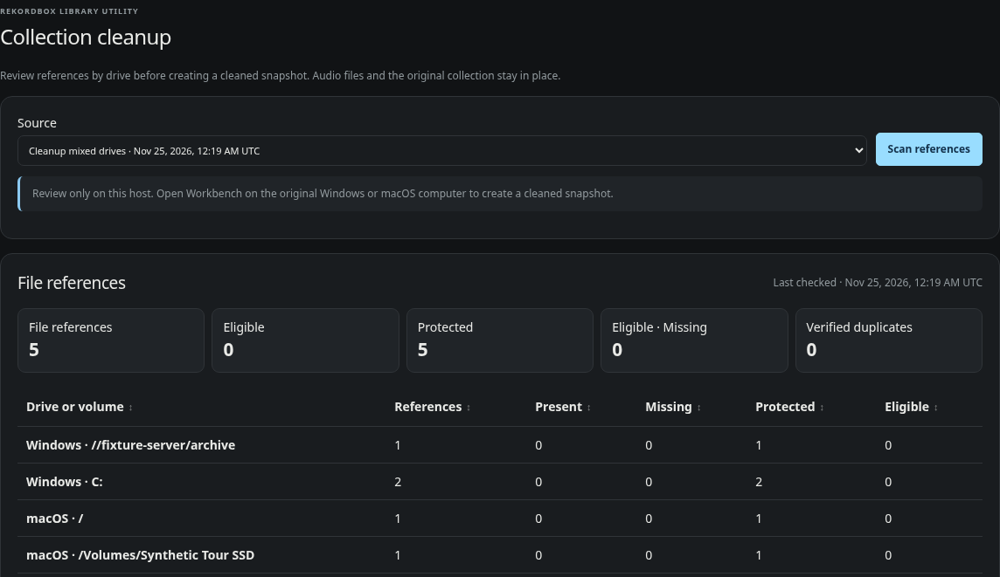

# Collection cleanup

Open **Cleanup & migration → Collection cleanup** to review a library that has moved between computers, disks or cloud accounts. The report counts references by their recorded Windows drive, macOS volume or unclassified location. You can run it on Linux to find out which computer or disk to check next.

## Read the evidence

1. Select a collection and choose **Scan references**. The default scan reads captured metadata and checks eligible local paths. It makes no cloud requests. Choose **Saved report** to revisit a previous scan for that source.
2. Review the totals by drive, then filter by volume, status or eligibility. **Missing** in the drive table counts confirmed absences in reachable local folders. **Eligible · Missing** counts the subset that also passed the preparation and source checks. **Protection reasons** can count a track more than once. Search for a track to see its path and individual findings.
3. If two paths look alike, inspect their evidence. Workbench can identify two references to one local file by filesystem identity. For distinct files, explicitly enable the complete-file comparison on a saved snapshot on the original computer. Only do this if its Music folder is always offline-accessible and outside sync services. Workbench reads eligible files of matching size and compares SHA-256 digests within an 8 GiB read budget per pass. The report shows bytes read and skipped comparisons. A matching name and size is only a lead.

| Finding | How Workbench treats it |
| --- | --- |
| Local file is absent | The file's immediate parent must still exist and be accessible inside the native Music folder on the startup disk. A disconnected parent cannot establish absence. |
| Identical local audio | A duplicate candidate needs a retained keeper with matching captured catalog metadata and evidence of the same file or identical bytes. Each candidate shows its keeper's ID and path. |
| Cloud, external or foreign path | Mapped cloud folders, known cloud placeholders, network shares, external disks and paths recorded on another OS are protected. An `E:` drive or `/Volumes/DJ USB` can be inspected later on its original computer. |
| Preparation or another possible copy | Playlists, cue and Hot Cue Bank links, play history, ratings, analysis, working edits, staged decisions and alternate locations can all protect a reference. Differing captured metadata can distinguish two references to identical audio. |
| Unknown evidence | Ambiguous track IDs, incomplete relationship coverage, unresolved smart playlist membership and older captures keep the report read-only. Individual tracks with unknown size, conflicting paths or metadata sidecars are held. |

## Filter a saved report

Use a preset to open eligible missing references, verified duplicates, protected
missing references, cloud locations, name-and-size leads or size conflicts.
For a narrower review, combine drive, status and text search with a protection
reason, comparison signal, proof type or a minimum and maximum recorded size in
MiB. Older reports can show their saved findings while leaving size unknown.
Run a fresh scan to populate the recorded and observed byte columns.

When copying is available, **Select eligible references on this page** adds only
eligible rows from the displayed page, up to the remaining selection capacity.
Review the selection and exact paths before confirming the copy.

## Create a cleaned Workbench snapshot

Use a newly captured Rekordbox XML collection or supported detached desktop database with relationship coverage. Choose **Save snapshot** for a workspace or source capture, then scan that saved snapshot. For an older capture, import the original source again first. A source that lacks the required evidence, including a USB export, can still be reviewed. Open the original linked workspace if the report marks its preparation state unavailable.

1. On the Windows or macOS computer that originally imported the music, select **1–25** eligible references and choose **Review selected references**. At least one track must remain. Review the exact paths, keepers and before/after counts.
2. Confirm the original computer and the always-local Music folder. Type the displayed phrase, such as `COPY 2`. A preview expires after 30 minutes. Workbench checks the selected files, keepers and protections again before saving. If a drive reconnects, a file changes or new edits affect the evidence, scan and review again.
3. Open the cleaned snapshot to inspect its tracks, or choose **Open original snapshot** to return to the full collection. The copy has its own working metadata scope. Start any further cleanup review from the original snapshot.

This operation only omits selected **references** from a new snapshot in Workbench's private database. It does not reclaim audio storage, delete cloud files, edit an XML export or write to AlphaTheta Rekordbox's `master.db` or USB library. The original source and snapshot remain available. [Library lab guide](LIBRARY-LAB.md)
