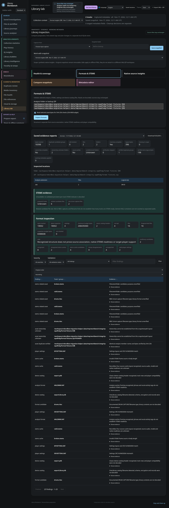
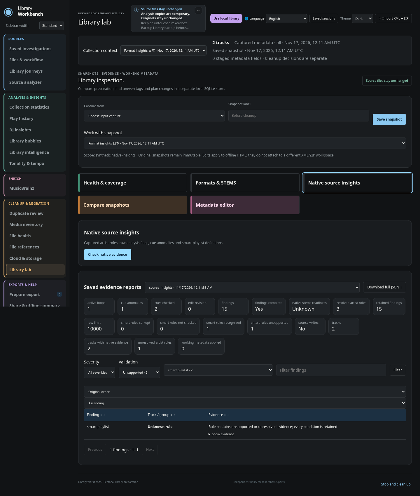

# Format, STEMS and native source inspection

Library lab includes **Formats & STEMS**, **STEMS workflows** and **Native source insights**. They save local evidence reports. Combine section, severity, validation, asset family/provider, cache state, source eligibility/provider and text filters; the JSON download includes all matching rows beyond the visible page. The [STEMS workflow guide](STEMS-WORKFLOWS.md) covers session declarations, NI containers and provider-cache completeness.

## Formats & STEMS

Select a saved snapshot, enter one or more absolute folder or backup-ZIP paths, one per line, and choose **Inspect formats**. Up to 20 scopes are accepted. A folder can contain device exports, player settings, ANLZ files or named STEMS candidates; a native desktop database is not required for the file checks. ZIP members are read directly without extraction.

| Format evidence | Checks performed | Remaining limits |
| --- | --- | --- |
| PMAI analysis containers | Framing, declared file/section lengths, section order and repeated tags; bounded PQTZ tempo/time validation; legacy/extended cue groups and known nested entries | Unknown sections are retained as identifiers. Individual waveform, phrase and vocal-detection payloads are not fully decoded. |
| Non-PMAI `ANLZ*.3EX` | Separate Unsupported analysis variant; possible MessagePack `embedding` signature retained as a hint | No payload validation, embedding interpretation, separated audio or native readiness is inferred. PMAI content under this extension still receives PMAI checks. |
| PQTZ tempo | Beat count, nondecreasing times, beat/BPM values, distinct tempos in BPM | Saved BPM comparisons require one unambiguous captured file reference. A path match does not independently establish audio identity. Variable grids need review rather than automatic correction. |
| PQT2 extended grid | Observed 56-byte-header revision `0x01000002`: count/body agreement and fractional values 0–999 microseconds within a millisecond | Per-section evidence distinguishes unknown revisions and incomplete prefixes. Stored checksum, cross-file association and multi-tempo semantics remain unverified. |
| PCOB / PCO2 cues | Separate hot/memory groups; declared entry counts and bounds; known cue/loop times; extended UTF-16 comments | Legacy active-loop evidence is retained separately from extended comments. Missing extended active-loop data stays unknown. Unsupported entry revisions are shown rather than guessed. |
| Player settings | Recognized MYSETTING.DAT, MYSETTING2.DAT, DEVSETTING.DAT and DJMMYSETTING.DAT layouts, lengths and CRC16/XMODEM | DJMMYSETTING covers header plus payload; the others cover payload only. Unknown payload revisions remain unsupported. No settings are written. |
| Classic `export.pdb` / `exportExt.pdb` | File/page alignment, header, table count, unique table types and initial/final page pointers | Header recognition does not decode device tracks or validate every page, row, relationship or player. |
| `exportLibrary.db` | Separate OneLibrary filename evidence | Encryption, schema and records are not decoded. Classic catalog changes cannot be assumed to update OneLibrary. |
| Recordbox `PDSTEMS1` cache | Magic, bounded frame count, exact logical byte length, four stereo sources at 44.1 kHz, duration and PCM16 layout | This format has no source/model identity in its header. Source association and native rekordbox readiness stay unknown. |
| NI `.stem.m4a` / `.stem.mp4` containers | Bounded ISO boxes, versioned NI JSON, four producer labels, mix/stem enable flags, stereo sample entries and presentation/edit timelines | Codec profiles, audio decoding, sample tables, mix consistency and target-player acceptance remain unverified. Generic five-stream media is not sufficient. |
| RB Stems Plus cache | Location marker, model/key layout, eight-channel FLAC STREAMINFO, finite RBD1/RBD2 descriptors, manifests and retention | Per-location completeness and selected source size/mtime consistency are metadata evidence; native preparation and audio identity remain unknown. |
| `.rbsc` and other named candidates | Filename evidence and supported container signatures | No native STEMS-ready count or player compatibility is inferred from a name or extension. |

Validation states are **Recognized**, **Corrupt**, **Unsupported** and **Not checked**. Recognized describes the checks listed for that format, not complete recovery or audio playback. Structural problems, unsupported semantics and budget-limited evidence are separate findings. In nested cue groups, entry-validation details remain available under **Show evidence**.

The inspector reads at most 2 MiB per prefix and 8 MiB of metadata per run. Local NI containers additionally support sparse metadata seeks within that actual-byte budget; ZIPs retain prefix-only inspection. It never allocates PCM buffers from a cache's declared frame count. A length-consistent Recordbox cache above the inspection policy's 12-hour limit stays Not checked; a policy limit alone does not establish corruption. Analysis inspection allows at most 1,024 sections and 4,096 entries per cue group; retained position details are capped at 64 per group. Inventory retains the existing directory, entry and time limits. Inspection checks a soft deadline between operations; a slow operating-system read can still delay cancellation until the next checkpoint.

The optional SHA-256 checkbox reads selected candidate bytes within the shared 256 MiB hash budget. Reports label newly computed fingerprints as **computed**: there is no trusted expected digest for an arbitrary selected file. A fully read ZIP member additionally has its embedded CRC checked. Identical analysis-member-set verification remains a separate comparison. Header inspection and full-file fingerprinting have separate byte counters; skipped, changed, unavailable and budget-limited files cannot become fully fingerprinted results. Local source stamps and the selected ZIP stamp are checked before report publication.

The [official rekordbox FAQ](https://rekordbox.com/en/support/faq/rekordbox7/) describes three-stem and four-stem modes. It also identifies `.rbsc` as DRUM CAPTURE samples with account and export restrictions. PSSI phrases and PVDI vocal activity are analysis evidence, not separated audio. This feature does not download models, perform separation, rewrite caches or delete assets.

## Native source insights

Capture a modern native library into a saved snapshot, select **Native source insights**, and choose **Check native evidence**. Older snapshots and XML-only sources may lack these fields; a fresh native capture is required to recover them.

- Composer, remixer, original artist and lyricist IDs resolve through the captured artist table. Resolved, unresolved, empty and not-captured values remain distinct. A lyricist foreign key is not displayed as an artist name.
- Release date, disc/track numbers, hot-cue autoload and raw analysis flags retain their captured values. Native BPM scaling, track duration in seconds and cue times in milliseconds are explicit. No native STEMS-ready flag is inferred.
- Cue checks identify unsupported native kinds, missing/invalid start times, invalid loop ends and inconsistent active-loop evidence. Native hot slots A–P retain their existing Kind mapping; an eight-pad device layout does not change that mapping.
- Smart-playlist definitions expose all/any logic, condition labels, operators, raw values, key lookups and signed MyTag IDs. Aliases include grouping → colour, producer → composer and counter → play count. BPM-rule units remain unverified rather than being guessed from value magnitude.
- Unsupported conditions are retained for inspection. Rules are never executed or applied to playlists. Document/entity declarations, nested unsupported structures, malformed definitions and excessive sizes/counts are held. Definitions above 64 KiB retain their criteria hash rather than their full text. The inspector allows at most 128 direct conditions.

Reports retain at most 10,000 findings and disclose omitted counts. Counters continue to describe checked evidence even when row retention is capped. Single-track details also expose captured native evidence. These records and smart rules stay in private snapshots/reports and are excluded from shareable metadata exports.

## Backup coverage correction

The four known player-settings basenames are classified before generic `.DAT` analysis files. Device catalogs have their own component. Optional ZIP byte verification also checks recognized settings CRCs: a sound ZIP member can still contain invalid settings bytes, and the report distinguishes those results. Captured `.3EX` references are checked as exact files; a `.2EX` sibling does not cover them.

## Evidence and validation

These screenshots use generated synthetic records and files from the real-server browser checks:

The work follows independently checked public layouts and the pinned [Recordbox implementation](https://github.com/fantuz/recordbox/tree/2cbe1de9bca9042dbab0676c6866ce1f6dcc1988). Its MECHANICS.md is a research ledger, with some stale entries and local-only reverse-engineering claims; it is not an official compatibility contract. The [broader integrity review](RECORDBOX-INTEGRITY-REVIEW.md) distinguishes the new engine/workflow changes, public PQT2 checks and remaining assumptions. Additional NI and cache-provider sources are pinned in the [STEMS guide](STEMS-WORKFLOWS.md).

Development checks independently inspected 15 public [rekordcrate fixtures at a pinned revision](https://github.com/Holzhaus/rekordcrate/tree/68cd702e9c78bde4b9eab477e0a7547a0cb69768/data). Their cue lists were empty; populated cue coverage in CI uses invented entries, with complementary legacy active-loop and extended-comment assertions. Public binary fixtures and local libraries are not distributed with this application.

Unit checks exercise malformed lengths, overflows, corrupt settings, unknown revisions, source mutation, cancellation, read limits, signed IDs, unresolved fields, rule bounds, filtered pagination and input preservation. Real-server Playwright checks run through the new tabs, filters, downloads, saved reports, native track evidence and mobile controls. They use generated synthetic files and real HTTP/SQLite operations, without intercepting API responses. Native library restoration, model quality, OneLibrary record support and physical-player acceptance require separate evidence.
