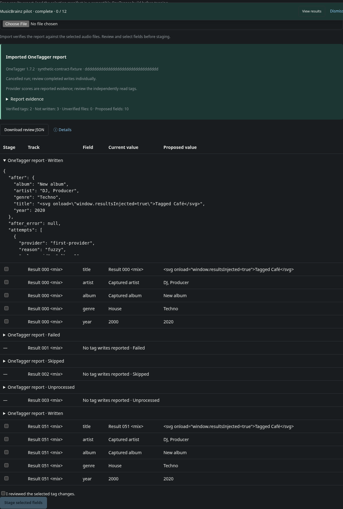

# OneTagger results exchange, version 1

This is a local, same-computer workflow: export a selection from rekordbox Migration Helper, load its JSON manifest in OneTagger, tag the selected files, then import the results JSON into that saved Helper selection.

Use a OneTagger build containing the producer changes in [OneTagger PR #47](https://github.com/fantuz/onetagger/pull/47), paired with [Workbench PR #67](https://github.com/fantuz/rekordbox-migration-helper/pull/67). Development builds can retain the same version number, so check the build's support for `onetagger.tagging-results` version 1. Producer native UI validation is tracked in its own PR; Workbench acceptance does not certify an installed OneTagger application.

## Use the bridge

1. In the Helper's **OneTagger bridge**, create a selection of 1–500 accessible tracks and download its JSON manifest.
2. In OneTagger, open **Auto tag → Input & Tags → Helper selection manifest (optional)** and choose that file. The manifest supplies the entire input selection and enables **Save tagging results JSON**. Review providers and tags, and disable both success and failure file moves.
3. Start tagging. The completion panel shows the results JSON path and an **Open results JSON** button. Reports are saved in the application's data directory under `runs/tagging-results-<run_id>.json`.
4. Return to the same saved Helper selection and use **Import OneTagger results JSON**. The Helper independently reads the selected audio and compares it with the report.
5. Review title, artist, album, genre and year. Select fields, unlock metadata edits, confirm the review and stage the selected fields. Import alone does not stage changes.

The review shows independently verified, unverified and not-written counts. A cancelled run can contain completed writes; only independently verified written rows offer fields. Provider scores retain their reported scale and are not treated as probabilities. Failed/skipped/unprocessed rows retain their evidence without proposed fields.

Use **Download review JSON** to retain the private review and its provenance. Saved selections and their latest reviews survive application restart. Staged metadata changes make an earlier review outdated: import or rescan again before selecting additional fields. Report evidence remains available for inspection.



The existing M3U handoff and **Rescan tags after OneTagger** remain available when a report is unavailable or stale. Rescanning makes a new review of current tags; it does not retain the imported report's provider evidence.

### CLI

Use a saved AutoTagger configuration, with file moves disabled:

```sh
onetagger-cli autotagger --path . --config config.json --selection-manifest onetagger-selection.json
```

The CLI still requires `--path`, but the manifest replaces that input with its exact selection. For a normal folder run, add `--report` to save results without a Helper identity. Generic reports cannot be imported into a saved Helper selection.

## Report contract

Reports identify their format with `schema: "onetagger.tagging-results"` and `version: 1`. They contain a unique 32-character hexadecimal run ID, application version/commit, creation/completion timestamps and an optional selection identity. The identity preserves `id`, `snapshot`, `snapshot_digest`, `scope_key` and `mapping_revision` without reinterpretation.

Each track records its Helper track ID (when present), original local path, final path, before/after tag snapshots, final file state, read errors and provider attempts. Several library IDs can reference the same file: OneTagger tags it once and reports every selected ID.

| Field | Meaning |
| --- | --- |
| `before`, `after` | Disk-read objects with nullable `title`, `artist`, `album`, `genre` strings and nullable integer `year`; null object on read failure |
| `file_state` | Final byte `size` and decimal-string `modified_ns`; timestamps use strings to preserve nanosecond precision in browsers |
| `status` | `written`, `failed`, `skipped` or `unprocessed` |
| `attempts` | Provider ID, optional provider track/release IDs, outcome, optional score/reason and Shazam-use flag |
| `before_error`, `after_error` | Optional read-failure explanation |
| `cancelled` | Whether the run observed cancellation; unprocessed selected rows remain present |

Successful fallback writes take precedence over earlier failed attempts, whose evidence is retained. Scores are provider evidence, not calibrated probabilities. Configuration, credentials, tokens and provider response bodies are excluded. Reports include local filenames and music metadata.

Snapshots describe stored scalar values, not proposed provider values. Vorbis uses the primary value; ID3/MP4 reconstruct their stored text separators. The Helper uses its own tag reader and blocks review eligibility when the readers disagree. Missing values never imply permission to erase library values. Final read-back happens before any configured post-command; a later change makes that report stale.

Selection manifests are limited to 2 MiB. Workbench accepts uploads up to 8 MiB with at most 100 attempts per track. A larger report remains available on disk, but requires a smaller selection or a tag rescan for review.

### Workbench upload and verification

`POST /api/onetagger/<selection-id>/import-results` accepts the producer's raw UTF-8 JSON file with the local action token. The original draft envelope `{"report": ...}` is also accepted within the same request limit. The browser sends file bytes directly, preserving nanosecond strings and duplicate-key detection. `digest` is SHA-256 of the uploaded JSON bytes; for an enveloped API request it includes that envelope.

Ambiguous duplicate keys, nonfinite numbers, invalid encoding, excessive size/depth, unsupported versions, foreign selections and incorrect membership/path mappings are rejected before audio read-back. Application/timestamp/provider fields are bounded; timestamps require timezone information. Configuration and raw provider-response fields are not retained. Scores must be finite, but no common provider scale is assumed.

Written rows need successful write evidence, final read-back and file state. Workbench checks file size and exact nanosecond mtime, then compares its independently validated tag values. Missing/invalid read-back, stale state, reader disagreements and unavailable files cannot offer edits. Stored release dates such as `2020-12-31` supply their year component. Repeated MP4 text atoms are joined with the producer's comma-space separator. Other unsupported multi-value or invalid metadata remains review evidence instead of being guessed or cleared.

These checks establish consistency with current selected-file metadata, not cryptographic audio identity or provider authenticity. Reported before-tags do not replace captured library baselines. Only the five independently read fields can be staged. File state is checked again before the transaction commits; a detected change rolls back values, history and revisions together.

See the shared [example fixture](fixtures/onetagger-results-v1.json).

## Review boundary

The Helper requires the supported report version and an exact saved selection identity, membership and path mapping. It opens files through its saved selection, never through paths supplied by a report. Current file state and tags must agree with reported read-back before any field becomes eligible for review. Failed/skipped/unprocessed rows remain evidence without proposed edits.

Import prepares a review only. Explicit field selection, edit unlock, revision checks, current-file revalidation and atomic staging remain required. Changed mappings, snapshots, files, reviews or staged metadata invalidate stale approval. Personal stars, cues, beat grids, play counts and playlist membership are outside this first contract. Library export continues through the Helper's existing XML/native ZIP writers.

Move/rename operations are excluded from Helper-bound tagging runs. Create a new selection after moving files. Generic reports can record final paths but do not authorize the Helper to relocate a library.

## Validation and limits

GitHub Actions covers actual tag read-back, fallback outcomes, cancellation, malformed reports, duplicate IDs, Unicode/percent filenames, changed files/mappings and preservation of unselected library fields. Both repositories check the same JSON contract fixture. Workbench browser acceptance uses real HTTP, SQLite and generated ID3/WAV metadata: selection across pages, raw report upload, cancelled/mixed outcomes, fallback evidence, duplicate JSON rejection, stale reports/reviews, explicit staging, downloads, 13 languages, mobile controls and saved reports through a server restart. The results workflow runs with the existing Chromium/Firefox/WebKit checks; the server-restart check runs in the Chromium workflow-integrity job.

Provider requests are synthetic/offline in these tests. The tests do not certify a live provider match or import into an installed rekordbox application. BPM/key/label editing and broader performance work are follow-ups.
