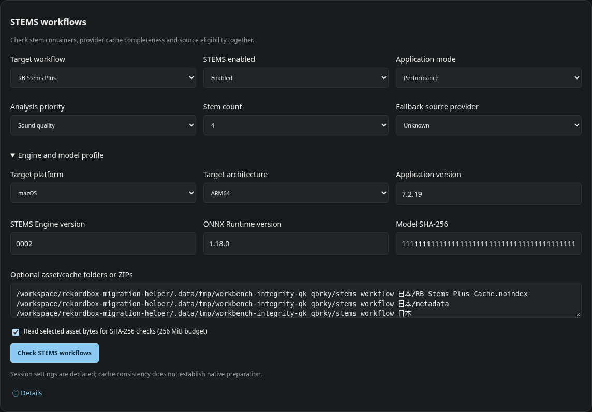

# STEMS workflow checks

Use **Library lab → STEMS workflows** to inspect saved source evidence, stem containers and existing provider caches. Select an immutable snapshot and declare the intended application settings. Optionally enter absolute asset/cache folder or ZIP paths, one per line, then choose **Check STEMS workflows**. Leave the paths empty for source and session advisories only. No native database is required for the file readers.

Reports are saved locally. Combine **Asset family**, **Asset provider**, **Cache completeness**, **STEMS eligibility** and **Source provider** with the existing section, severity, validation and text filters. Filters apply before pagination, sorting and full JSON downloads. Facets retain the whole report's choices so an empty intersection can be reversed. Reopening a report reads saved evidence; run a new check after reconnecting a drive or changing a source, model or cache.



## Source and session evidence

The versioned profile `2026-11-17.1` records the target workflow, enabled state, PERFORMANCE/EXPORT mode, quality/speed priority, three/four-stem selection, platform, architecture, application/engine/runtime versions and optional full SHA-256 model fingerprint. These are user declarations, not detected running preferences. An empty value stays unknown.

The [official rekordbox 7 FAQ](https://rekordbox.com/en/support/faq/rekordbox7/) excludes STEMS for **Apple Music and Spotify**. The [7.2.18 manual](https://cdn.rekordbox.com/files/20260807093645/rekordbox7.2.18_manual_EN.pdf), pages 213 and 250, documents PERFORMANCE mode, three/four stems and quality/speed settings. It does not supply a persistent per-track preparation flag.

| Eligibility state | Evidence |
| --- | --- |
| Blocked | A captured/named Apple Music or Spotify provider, a declared disabled STEMS setting, or declared EXPORT mode |
| Candidate | A recorded local file reference plus declared enabled STEMS and PERFORMANCE mode |
| Unknown | Other streaming services, unmapped native service IDs, missing source evidence or incomplete session settings |

A local reference does not prove access, decoding, subscription/plan support, memory availability or native preparation. The provider fallback applies only when captured evidence cannot identify a provider; reports retain that declared basis. Native `ServiceID` values are preserved privately with a capture-presence flag. Numeric IDs are not guessed from undocumented mappings. Existing snapshots can lack the evidence; capture again to obtain it. Source evidence is excluded from public metadata exports.

For RB Stems Plus, declared speed/EXPORT/disabled settings or Windows/Linux targets conflict with the inspected provider profile. Version combinations outside the reviewed application 7.2.17–7.2.19, STEMS Engine `0002`, ONNX Runtime `1.18.x`, macOS ARM64 quality-mode path remain unverified. A matching declared profile is a comparison against pinned community source, not independent native certification. Three/four-stem selection is recorded as context and does not rewrite cache channel layout.

## Native Instruments containers

Discovery recognizes `.stem.m4a`, `.stems.m4a`, `.stem.mp4` and `.stems.mp4`, case-insensitively. The bounded ISO reader skips media payload boxes and checks:

- Ordinary, extended 64-bit and to-end box lengths; parent boundaries, box-count and depth limits.
- `moov/udta/stem` JSON version 1 with four bounded producer-defined names and colours. Labels need not be drums/bass/other/vocals. Duplicate JSON keys are rejected; mastering-metadata presence is recorded without applying DSP.
- One enabled mix followed by four disabled audio stem tracks, unique nonzero track IDs, stereo channels, sample-entry type, sample rates, media durations and presentation timelines including supported edit lists.
- Matching presentation starts/durations within one sample, supported unit-rate edits and finite, available time information. Missing metadata, encrypted/unknown sample entries, unsupported revisions and timing differences remain explicit.

`mp4a` and `alac` identify sample-entry types; codec profile remains **unverified**. Recognized means NI-style metadata and track structure passed the implemented checks. Sample tables, payload decoding, codec delay/PTS beyond those metadata checks, mastering behavior, mix consistency and Traktor/rekordbox acceptance are not established. A generic ISO signature or five streams without NI metadata cannot become a recognized NI file.

Local files allow sparse metadata seeks: a movie header after a large `mdat` can be inspected without reading its audio. ZIP inspection uses a bounded decompressed prefix; a movie header beyond it remains **Not checked**. There is no extraction, ffmpeg invocation or added decoder dependency.

## RB Stems Plus cache evidence

The adapter follows [RB Stems Plus at `bb673167`](https://github.com/Gabe-LS/rbstemsplus/tree/bb6731672a68b03de2e485901c57736aed349824). It reads existing files and does not install the bridge or modify a vendor runtime.

```text
~/Library/Caches/rbstemsplus/<model namespace>/<key[:2]>/<key>.flac
                                                          <key>.desc

External cache: RB Stems Plus Cache.noindex/
Location marker: .rbstemsplus-cache
Preparation: *.manifest
Retention: *.kept
```

| Evidence | Checks and meaning |
| --- | --- |
| Location marker | UUID, unique fields and `format=rbstems-v1`; an arbitrary external cache needs a recognized marker. The standard `rbstemsplus` default layout is identified separately. |
| FLAC chunk | STREAMINFO properties: 44.1 kHz, eight channels, 16 bits and a nonzero sample count. Payload frames are not decoded. |
| Channel/gain policy | Inspected provider order is drums L/R, bass L/R, other L/R, vocals L/R; stored gain is 0.5 and restore gain is 2. These are provider conventions, not measured loudness or clipping results. |
| `.desc` | RBD1/RBD2 magic, 1–512 summary frames, exact size, finite summaries and consistency with `min(FLAC samples // 4410, 512)`. RBD1 uses `16 + 8N` bytes; RBD2 uses `24 + 16N`. |
| `.manifest` | Strict bounded syntax; helper/model/playlist identity; per-file path, size, nanosecond mtime, completion flag and expected chunk keys. Every expected FLAC/descriptor pair is checked within each individual cache scope. |
| `.kept` | Expiry and model/key references. Protected or expired describes eviction protection, not completed preparation. Expiry alone never marks complete audio stale. |

The model namespace can be a model SHA-256 or, for the inspected `PIONEER_0002` model, the provider's derived `sha256("rbstems-rebuild-1:" + model_sha256)` namespace. Matching names establish consistency with a declared fingerprint; the application never reads a model or recomputes a provider's audio-derived chunk key.

Physical cache roots and individual ZIPs remain distinct even if they carry identical location UUIDs. Chunks from separate locations cannot be combined to make a manifest appear complete. Missing companions, invalid descriptors, incomplete manifest flags and missing final chunks are reported separately from source staleness. Partial inventory/read budgets cannot establish completeness. Temporary outputs remain incomplete candidates.

| Cache state | Meaning |
| --- | --- |
| Present | A scoped FLAC/descriptor pair has matching supported metadata; source identity and audio remain unverified |
| Manifest consistent | The manifest declares completion, every expected pair is structurally present in this cache, and selected source size/mtime agrees |
| Incomplete | Expected chunks or companions are absent/invalid in a complete inventory, or the manifest records interrupted preparation |
| Stale | Present cache evidence refers to different source size or nanosecond mtime |
| Profile mismatch | Otherwise consistent cache evidence conflicts with the declared model or supported session profile |
| Unavailable | An explicitly selected location is missing or inaccessible; reconnect and run a new check |
| Unknown | Source out of scope, linked/unavailable source, ambiguous records, no expected keys, unrecognized location, unsupported metadata or inspection limits |

Manifest paths never authorize reading arbitrary audio. Only metadata of regular, locally available, link-free sources inside explicitly selected folder scopes is checked. Source metadata is checked again before publication. No source bytes are read through a manifest reference. Optional selected-asset SHA-256 reads are separate and bounded; a hash without a trusted expected value does not authenticate an audio/cache association.

**Manifest consistent is not content identity or native readiness.** A same-size edit with restored mtime can still match this provider metadata. A perfect sum of stems, whole-track correlation or a mono fingerprint cannot establish separation quality: a brief edit or swapped stereo channels may escape those measures. The application does not use approximate audio matching to approve caches.

## Bounds and recovery

At most 20 scopes are accepted. Existing inventory limits are 160,000 directories, 300,000 entries and a soft 45-second deadline. Metadata reads share an 8 MiB actual-byte budget; prefixes are at most 2 MiB, NI JSON at most 64 KiB, ISO boxes at most 2,048, and manifest/retention references at most 16,384 per file. Provider and source-advisory rows are each capped at 10,000 with completeness disclosed. Optional selected-asset hashing shares the existing 256 MiB budget.

Operations expose cooperative cancellation checkpoints. Incomplete inventory and bounded reads retain unknown evidence. Slow operating-system reads can delay cancellation. Modified inspected files, referenced sources or selected ZIPs abort publication; immutable snapshots and older saved reports remain available. An unavailable selected location gets its own finding. An empty accessible scope records no cache evidence. Neither case establishes missing native preparation.

## Research provenance and validation

- [stempeg NI writer at `a41eaabb`](https://github.com/faroit/stempeg/blob/a41eaabb6761c9cdc3a079c45a1a2ccd575afea6/stempeg/write.py#L450): five-stream ordering, producer labels and enable flags.
- [RB Stems Plus source at `bb673167`](https://github.com/Gabe-LS/rbstemsplus/tree/bb6731672a68b03de2e485901c57736aed349824): provider cache, descriptors, manifests, retention and compatibility declarations.
- [Synchronized `fantuz/recordbox` at `2cbe1de9`](https://github.com/fantuz/recordbox/tree/2cbe1de9bca9042dbab0676c6866ce1f6dcc1988): substantial HTDemucs/Metal and workflow changes; buffered durable cache writes and fine-tuned checkpoint hashes. Its `PDSTEMS1` layout remains supported. Path/size/whole-second-mtime cache identity, existing-model verification, whole-track allocation, linear resampling and PCM16 clamping remain open concerns. See the [broader integrity review](RECORDBOX-INTEGRITY-REVIEW.md) for independently checked evidence and limits.
- Official FAQ/manual above: service restrictions and declared session behavior. Community implementation claims are kept separate from official documentation and independent tests.

Development research generated small silent NI-like AAC containers and eight-channel FLAC controls, independently decoded with ffprobe. Those probes establish only those generated samples' metadata/decoder behavior, not native acceptance. CI uses synthetic headers, descriptors and manifests with no songs, model weights, vendor binaries or installed DJ applications.

Unit/API checks cover malformed metadata, unknown revisions, timing/channel/track differences, budgets, cancellation, missing and split caches, expiry, source edits, model/profile changes, symlink and scope boundaries, disconnect/reconnect, service capture/privacy, global filters and saved downloads. The existing real-server Playwright workflow now checks the STEMS tab, 125-track pagination, all five filters, source-only checks, stale/incomplete/unavailable evidence, reconnect, invalid-profile rejection, 13 languages, mobile layout, immutable inputs and report persistence through server restart. It uses real HTTP and SQLite without API interception.

Native live readiness, restored playback, hardware/USB export compatibility, channel audio correctness, headroom, separation quality and resource consumption need dedicated application/audio evidence. They remain unverified; no separated audio is generated or rewritten by these checks.
