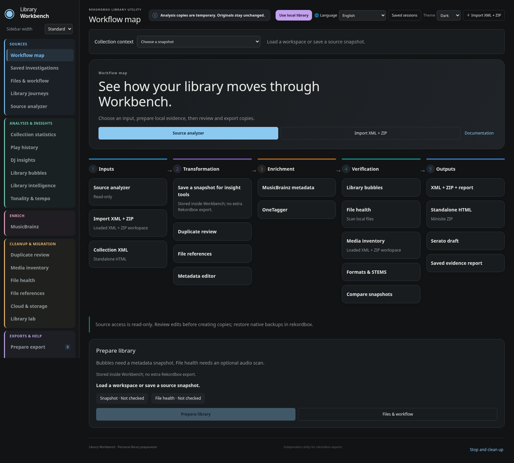

# Choose a workflow

The **Workflow map** opens in a new browser tab. Click a box to open its tool.
The columns show inputs, transformation, enrichment, verification and outputs.
Returning tabs retain their last page; direct links still open the requested
tool. Each input has its own capabilities.

## Prepare your input

- **Source analyzer:** choose the local database folder or a copied supported
  database. Close rekordbox and pause library sync during capture. Workbench
  reads a consistent private copy and leaves originals unchanged. Collection
  XML can also supply metadata, with fewer capabilities.
- **Import XML + ZIP:** make consecutive Backup Library ZIP and collection
  XML exports from the same library edition. Keep untouched copies separately.
  This workspace supports duplicate decisions, path staging and paired exports.
- **Collection XML:** the sharing page accepts XML alone for metadata and
  offline summaries. XML does not create a native backup.

Connect your audio drive for availability, playback or tag checks. Database
paths and XML references do not contain music. Make cloud-only audio locally
available using your provider's tools before inspecting it.

After loading, a dialog offers an internal metadata snapshot. **Also scan
local audio files now** is off by default. Choose **Not now** to defer, then
return from the map, collection header or insights. Opening a page never
starts a full file-health scan.

## How many extra files do I create?

**No additional Rekordbox export is needed for bubbles or file health.**
Workbench saves their evidence internally; they are not two files you must
export and upload yourself.

| Feature | Requirement | Who creates it? |
| --- | --- | --- |
| Bubbles, DJ insights, tonality | Immutable metadata snapshot for the chosen edition | Workbench on request; the same scope's existing snapshot is reused |
| File health | Explicit scan, connected audio and folder mappings where paths changed | Workbench stores scan results internally |
| Media inventory/recovery | Loaded XML+ZIP workspace and music folders to search | You select folders; Workbench stores results |
| Playback/tag read-back | Accessible original audio | Existing files, not another export |
| Formats, analysis and STEMS | Existing analysis folders, caches or asset-containing backups | Select locations; unavailable evidence stays unknown |
| Migration comparison | Separate captures of source and actually restored destination | Workbench saves each edition; one snapshot cannot verify both sides |
| MusicBrainz | Network consent and source-bound metadata | Workbench retains batches and proposals |
| OneTagger | Workbench handoff, explicit external run and optional producer report | Workbench creates the handoff; OneTagger creates its report; Workbench independently reads tags back |
| Copy export/restore testing | Untouched native backup, plus audio if excluded | Create the backup in rekordbox; test restoration separately |

Preparation reuses the latest snapshot for the exact workspace or capture
scope. A new edition has a different scope. Named comparison snapshots can
still be created deliberately in Library lab. Preparation does not rescan the
original source, regenerate STEMS, download cloud music or contact providers.

Missing genres/colours become unknown bubble groups; no audio scan is needed.
XML cannot supply native histories or fields never exported. File health
checks accessibility and headers, not full decoding, byte identity or STEMS
quality. A scan cannot reconstruct absent native evidence.

## Which library does Media inventory check?

**Media inventory checks the loaded XML+ZIP workspace**, named on its card.
The collection header can select a different snapshot without changing that
recovery-search input. Use **File health** and **Audio folders** to inspect a
selected capture or snapshot instead.

1. Import the pair whose original references you want to check.
2. Add **Folder on this computer** paths containing music. These are search
   folders, not ZIP files, database folders or export destinations.
3. Expand **Optional path mapping** if needed. A recorded `D:/Music` prefix may
   now correspond to a mounted folder elsewhere. The export reference prefix
   is needed only to stage a candidate for a copy export.
4. Run **Scan these folders**. Advanced relocation additionally reads tags and
   duration; it may take longer and does not rename files.
5. Review candidates. A unique suggestion is not proof of audio identity.
   Ambiguous/unavailable evidence cannot be staged as a unique match. Stage
   or undo references and review them before export.

**Remove** takes a folder out of the next scan settings. It never deletes the
directory, music or saved report. Changed settings are labelled separately
from previous results. Reload restores the last successful scan's folders.
Draft settings stay isolated by workspace while the page remains open.

Searches use original references; staged paths apply to copy exports. To
check a translated or restored library, import its new XML+ZIP pair. An old
workspace cannot certify an unloaded destination. Absence from selected
folders does not prove permanent loss; disconnected locations stay unverified.

## Changes and outputs

Duplicate choices, reference changes and metadata overrides are staged
locally. MusicBrainz supplies proposals for review. OneTagger is a separate
application that can write tags through its own explicit workflow.

Outputs include edited XML/native ZIP plus reports for supported paired
inputs, offline HTML/minisite summaries, handoffs, evidence reports and
compatibility-limited Serato drafts. A capture or metadata snapshot is not a
full backup. Direct library access means read-only capture, not editing the
live database. Restore copies in rekordbox, in an isolated library first,
then capture the destination for comparison.

See [input/restore steps](INPUTS-AND-RESTORE.md),
[compatibility](COMPATIBILITY.md), [recovery](RECOVERY.md),
[Library lab](LIBRARY-LAB.md), [OneTagger](ONETAGGER-RESULTS.md) and
[STEMS evidence](STEMS-WORKFLOWS.md).
